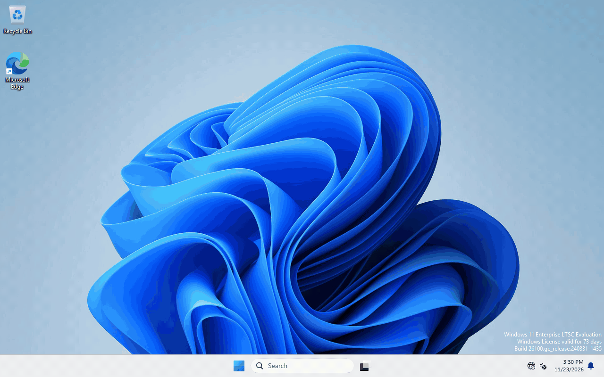

# asa — attack surface analysis for Windows and Linux

Take a snapshot of a Windows or Linux machine, install or change something, take a second
snapshot: asa tells you what changed in the attack surface and whether it matters.

A rewrite in Rust inspired by Microsoft's
[Attack Surface Analyzer](https://github.com/microsoft/AttackSurfaceAnalyzer).

> asa is an independent project. It is not affiliated with, endorsed by or supported by
> Microsoft.



*Reviewing a Google Chrome Enterprise install on a Windows 11 VM: snapshot, install,
snapshot, summary in the terminal, then the web UI. Long collection waits are cut.*

- **One file, no install.** `asa.exe` and the static Linux `asa` need no runtime and never use
  the network.
- **Covers what attackers use:** files, services, drivers, firewall, COM, registry persistence,
  users, rights, certificates, ports, scheduled tasks, Defender, WMI, security options, keys,
  TPM and Wi-Fi on Windows; files (owners, modes, setuid), accounts, systemd services and
  listening ports on Linux, with Linux rules for persistence, trust, privilege and malware
  traces.
- **Fast on real machines:** about 4× faster end to end and 20× less memory than the original
  (see the [comparison](docs/comparison.md)).

## Quick start

From an **elevated** PowerShell:

```powershell
.\asa.exe collect --run-id before
# ... install or change something ...
.\asa.exe collect --run-id after
.\asa.exe serve --open          # web UI
.\asa.exe diff before after     # or a report in the terminal
```

On Linux, as root:

```bash
sudo ./asa collect --run-id before
# ... install or change something ...
sudo ./asa collect --run-id after
sudo ./asa serve                # web UI on http://127.0.0.1:8740/
sudo ./asa diff before after    # or a report in the terminal
```

The database maps the machine's weaknesses, so asa creates it readable by its owner only
(root here) on Linux, and by administrators only on Windows.

Download the Windows zip or the Linux tarball from
[Releases](https://github.com/aaakube/AttackSurfaceAnalyzer-rs/releases) (check it against its
`.sha256`), or build them yourself:

```bash
scripts/package.sh              # dist/asa-<version>-windows-x64.zip, -linux-x64.tar.gz, .sha256
```

## Documentation

| | |
|---|---|
| [Usage](docs/usage.md) | Commands, web UI, query language, triage |
| [What is collected](docs/collectors.md) | Every collector and its fields |
| [Rules](docs/rules.md) | Writing and checking detection rules |
| [Analyzer plugins](docs/plugins.md) | Post-diff analysis passes you can add per technology |
| [Deployment](docs/deployment.md) | Installing and verifying the release bundle |
| [Process Monitor](docs/procmon.md) | Seeing which process made each change |
| [Internals](docs/internals.md) | Storage, scaling, development and CI |
| [Comparison with the original](docs/comparison.md) | Features and measured speed |
| [Worked example](docs/example-assessment.md) | A LibreOffice assessment driven by asa |
| [Roadmap](docs/roadmap.md) | Planned improvements and ideas |

## License

MIT, see [LICENSE](LICENSE). Some default rules are adapted from Microsoft Attack Surface
Analyzer (© Microsoft Corporation, MIT); see [THIRD_PARTY_NOTICES.md](THIRD_PARTY_NOTICES.md).
